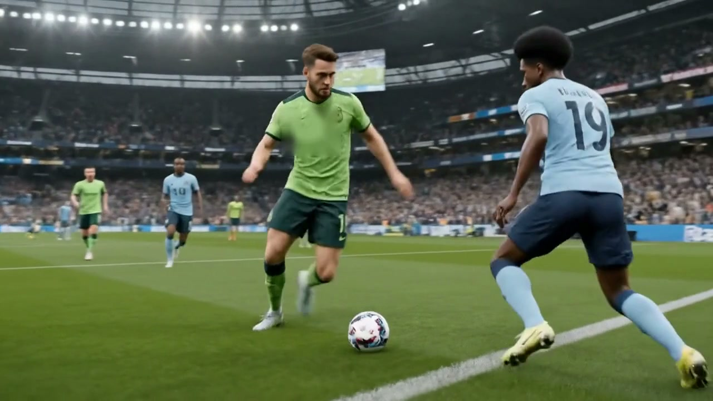
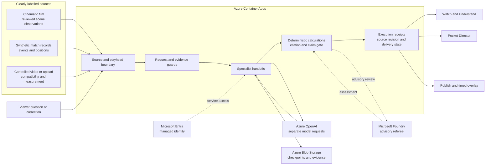

# Before the Roar

**Watch the play. Understand the evidence. Correct the story.**

Before the Roar (BTR) is an explainable football studio for fictional matches. It turns synthetic events into time-linked commentary, useful measurements and audience-specific stories. Viewers can inspect the evidence behind a claim, change an observation in Truth Lab and see which parts of the story must be corrected.

| Explore                                                                                                          | Verify                                           | Watch                                                                                                                                             |
| ---------------------------------------------------------------------------------------------------------------- | ------------------------------------------------ | ------------------------------------------------------------------------------------------------------------------------------------------------- |
| [Live application](https://before-the-roar.icypebble-9d6c9f05.eastus2.azurecontainerapps.io/)                    | [Release evidence](docs/RELEASE.md)              | [1:53 judge demo on YouTube](https://youtu.be/SKLyG0z_bEc)                                                                                        |
| [Pocket Director](https://before-the-roar.icypebble-9d6c9f05.eastus2.azurecontainerapps.io/pocket-director.html) | [Judge walkthrough](docs/JUDGE-DEMO.md)          | [Download the HD demo](https://before-the-roar.icypebble-9d6c9f05.eastus2.azurecontainerapps.io/assets/before-the-roar-judge-v206.mp4?download=1) |
| [15-image product story](https://before-the-roar.icypebble-9d6c9f05.eastus2.azurecontainerapps.io/story.html)    | [Submission draft](docs/HACKATHON-SUBMISSION.md) | [Video edit provenance](demo/showcase-v206/judge-provenance.json)                                                                                 |



_Cinematic film frame. Structured match calculations and controlled-video measurements come from separately labelled sources._

## One play, five stages

| Stage          | Viewer action                                                          | What BTR returns                                                                                                                       |
| -------------- | ---------------------------------------------------------------------- | -------------------------------------------------------------------------------------------------------------------------------------- |
| **Watch**      | Follow the cinematic minute and ask the crew about the reached moment. | A source-bounded discussion, with an AI desk that identifies model calls, calculations, replay and fallback.                           |
| **Understand** | Choose a newcomer, tactical, math or player-focused perspective.       | An explanation of what is visible, why it may matter and what to watch next.                                                           |
| **Measure**    | Analyze the included fictional evaluation clip or a compatible upload. | Controlled-video event candidates, enrolled identities and calibrated ground-plane measurements, with source and compatibility labels. |
| **Challenge**  | Change one synthetic tracking observation in Truth Lab.                | Original and revised evidence side by side, an updated calculation and a withdrawn claim where its support disappeared.                |
| **Publish**    | Review the corrected story for an audience.                            | Timed, machine-readable cues with explicit preparation, delivery and evidence states.                                                  |

**Engineers** and **Secure** expose the implementation and its safeguards. They support the five-stage audience journey rather than adding more steps to it.

## Architecture

The application and API run on Azure Container Apps. Microsoft Entra managed identity is used for Azure service access. Separate specialist requests use Azure OpenAI; deterministic code calculates measurements and enforces the final claim gate. Microsoft Foundry provides an _advisory_ review of completed public work. Azure Blob Storage retains checkpoints and evidence for recovery.



The film desk makes separate **Scout**, **Guide** and **Host** model requests. **Vector** calculates and **Check** applies deterministic evidence rules. The synthetic-match desk uses four model roles, with Vector remaining deterministic. The public receipts distinguish fresh model work from saved replay, calculation, recovery and reviewed fallback. Foundry's advisory assessment cannot override the deterministic release gate.

## The defining interaction

Truth Lab changes a synthetic defender's recorded lateral displacement from **13.0 m to 0.0 m**. BTR recalculates the affected value, withdraws the unsupported movement claim and revises the broadcast line. The two completed passes remain supported. This demonstrates that the explanation depends on its evidence; it does **not** prove why the defender moved.

**Next Angle** lets the viewer ask whether an authored alternative tracking view supports that movement claim, or mark the view unavailable. It shows the original and corrected revisions together and exports the cue with source IDs. This interaction is a labelled synthetic alternative, not a new camera feed or model request.

Pocket Director receives the reached evidence and source revision, so the corrected story can appear on a paired phone. Local-upload pairing transfers bounded evidence, not video bytes. Accessibility options include captions and transcripts, descriptive and evidence-bounded replay, color-vision palettes, reduced motion, visual signals and optional supported-device haptics.

## Evidence boundaries

| Source                         | What it supports                                                                          | What it does not establish                                                                     |
| ------------------------------ | ----------------------------------------------------------------------------------------- | ---------------------------------------------------------------------------------------------- |
| **Cinematic film**             | Reviewed visible actions and scene-local discussion.                                      | Continuous measured play, calibrated speed, enduring player identity or tactical causality.    |
| **Synthetic match records**    | Deterministic positions, pass calculations, evidence revisions and recaps.                | Real-league calibration or causal proof.                                                       |
| **Controlled synthetic video** | Enrolled-marker tracking, pass and shot candidates, calibrated ground-plane measurements. | General broadcast-camera recognition, aerial ball speed or unrestricted player identification. |
| **Uploaded clip**              | A compatibility decision and supported local measurements or reviewed cues.               | Automatic compatibility with arbitrary football video.                                         |

The cinematic minute is an edit of eight independently generated shots. Its measurements are **never borrowed** from the separate synthetic match or controlled training video. No real Premier League match data is distributed.

### What has been verified

- The [frozen controlled-video holdout](docs/proof/v146-tracking-holdout.md) matched **39 of 40 events** across five procedural cases and retains a low-light miss. It is not an unfamiliar broadcast-video benchmark.
- The [unfamiliar-domain result](docs/proof/external-video-results.json) demonstrates withholding when compatibility is not established. It does not measure broadcast event-detection accuracy.
- The [live commentary record](docs/proof/v181-intent-and-host.md) retains failures and fallbacks. Independent human preference for the specialist crew over one model remains unproven.
- Automated tests establish software behavior, not editorial superiority or football causation. The [release evidence index](docs/RELEASE.md) records verification and open limits.

## Run locally

Use Node.js 22 and install the pinned dependencies:

```sh
npm ci
npm run studio
```

Open <http://127.0.0.1:4397/>. Reviewed explanations, saved receipt replay and synthetic calculations work without Azure credentials. Live Azure model requests require explicit configuration and remain subject to the model allowance. To verify the source:

```sh
npm test
npm run check
npm run format:check
```

See [deployment instructions](docs/DEPLOYMENT.md), [asset rights](docs/ASSET-RIGHTS.md) and the [historical README](docs/archive/README-pre-v182.md). The repository does not submit the project to the hackathon or accept its legal terms.
