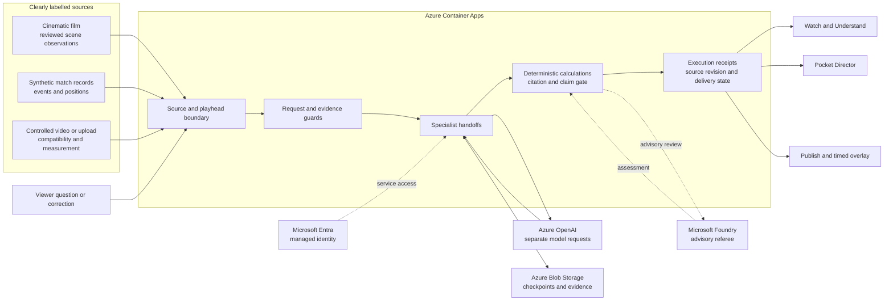
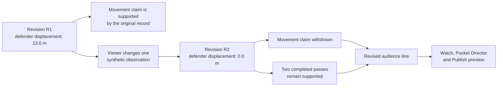

# Before the Roar

**Watch the play. Understand the evidence. Correct the story.**

Before the Roar (BTR) is an explainable football studio for fictional matches. It turns synthetic events into time-linked commentary, useful measurements and audience-specific stories. Viewers can inspect the evidence behind a claim, change an observation in Truth Lab and see which parts of the story must be corrected.

Most football products can tell you **what** happened. BTR asks a harder question: **what can this explanation actually prove?** A new fan needs a clear reading of the play, an analyst needs the supporting calculation, and a producer needs to know whether a line is safe to put on screen. BTR gives all three audiences a view of the same reached evidence while preserving the difference between an observation, a calculation and an interpretation.

| Explore                                                                                                          | Verify                                           | Watch                                                                                                                                             |
| ---------------------------------------------------------------------------------------------------------------- | ------------------------------------------------ | ------------------------------------------------------------------------------------------------------------------------------------------------- |
| [Live application](https://before-the-roar.icypebble-9d6c9f05.eastus2.azurecontainerapps.io/)                    | [Release evidence](docs/RELEASE.md)              | [1:53 judge demo on YouTube](https://youtu.be/SKLyG0z_bEc)                                                                                        |
| [Pocket Director](https://before-the-roar.icypebble-9d6c9f05.eastus2.azurecontainerapps.io/pocket-director.html) | [Judge walkthrough](docs/JUDGE-DEMO.md)          | [Download the HD demo](https://before-the-roar.icypebble-9d6c9f05.eastus2.azurecontainerapps.io/assets/before-the-roar-judge-v206.mp4?download=1) |
| [15-image product story](https://before-the-roar.icypebble-9d6c9f05.eastus2.azurecontainerapps.io/story.html)    | [Submission draft](docs/HACKATHON-SUBMISSION.md) | [Video edit provenance](demo/showcase-v206/judge-provenance.json)                                                                                 |


_Cinematic film frame. Structured match calculations and controlled-video measurements come from separately labelled sources._

### See the idea in two minutes

1. [Watch the 1:53 judge cut](https://youtu.be/SKLyG0z_bEc). It follows a play, a viewer challenge and the corrected story across desktop and phone.
2. [Open the live application](https://before-the-roar.icypebble-9d6c9f05.eastus2.azurecontainerapps.io/). Play the fictional film, then inspect the Watch Party and its AI desk receipts.
3. In **Challenge**, change the defender record in Truth Lab. Compare the original and revised claims, then follow the corrected line into **Publish**.

The demo is an edited product walkthrough. Azure AI Speech narration was added during editing; it is not a live agent voice. The [source edit record](demo/showcase-v206/judge-provenance.json) identifies the footage and capture lineage.

## One play, five stages

| Stage          | Viewer action                                                          | What BTR returns                                                                                                                       |
| -------------- | ---------------------------------------------------------------------- | -------------------------------------------------------------------------------------------------------------------------------------- |
| **Watch**      | Follow the cinematic minute and ask the crew about the reached moment. | A source-bounded discussion, with an AI desk that identifies model calls, calculations, replay and fallback.                           |
| **Understand** | Choose a newcomer, tactical, math or player-focused perspective.       | An explanation of what is visible, why it may matter and what to watch next.                                                           |
| **Measure**    | Analyze the included fictional evaluation clip or a compatible upload. | Controlled-video event candidates, enrolled identities and calibrated ground-plane measurements, with source and compatibility labels. |
| **Challenge**  | Change one synthetic tracking observation in Truth Lab.                | Original and revised evidence side by side, an updated calculation and a withdrawn claim where its support disappeared.                |
| **Publish**    | Review the corrected story for an audience.                            | Timed, machine-readable cues with explicit preparation, delivery and evidence states.                                                  |

**Engineers** and **Secure** expose the implementation and its safeguards. They support the five-stage audience journey rather than adding more steps to it.

## Architecture

The application and API run on Azure Container Apps. Microsoft Entra managed identity is used for Azure service access. Separate specialist requests use Azure OpenAI; deterministic code calculates measurements and enforces the final claim gate. Microsoft Foundry provides an _advisory_ review of completed public work. Azure Blob Storage retains checkpoints and evidence for recovery.



The film desk makes separate **Scout**, **Guide** and **Host** model requests. **Vector** calculates and **Check** applies deterministic evidence rules. The synthetic-match desk uses four model roles, with Vector remaining deterministic. The public receipts distinguish fresh model work from saved replay, calculation, recovery and reviewed fallback. Foundry's advisory assessment cannot override the deterministic release gate.

### A specialist crew with inspectable jobs

| Specialist | Contribution                                                                      | Execution boundary                                                                                                                          |
| ---------- | --------------------------------------------------------------------------------- | ------------------------------------------------------------------------------------------------------------------------------------------- |
| **Scout**  | Selects a visible or recorded football observation worth discussing.              | Azure model request, bounded to the current source and playhead.                                                                            |
| **Guide**  | Explains the football concept and frames a useful viewer question.                | Azure model request that can read the accepted prior contribution.                                                                          |
| **Vector** | Computes quantities from reached structured records.                              | Deterministic code, not a model request.                                                                                                    |
| **Check**  | Challenges unsupported inference and tests citations against the source contract. | Deterministic rules for the film desk; a separate model role in the synthetic-match desk, with deterministic release checks still in force. |
| **Host**   | Synthesizes what the combined evidence changes about the viewer's understanding.  | Separate Azure model request, followed by validation and possible bounded repair or labelled fallback.                                      |

The two desks have different execution graphs because the edited film does not contain continuous tracking. BTR does not present a deterministic calculation as a model call, a saved answer as live reasoning, or a public role handoff as private chain-of-thought. The **AI desk** reports execution type, evidence identifiers, checks and delivery status so the audience can inspect the path from input to answer.

### Microsoft services in the running path

| Service                  | Role in BTR                                                         | Boundary                                                                           |
| ------------------------ | ------------------------------------------------------------------- | ---------------------------------------------------------------------------------- |
| **Azure Container Apps** | Hosts the web app, API, orchestration and deterministic validation. | HTTPS ingress, request limits and source-aware API checks.                         |
| **Microsoft Entra ID**   | Supplies a user-assigned managed identity for service access.       | Azure RBAC scopes access to the model, Foundry project and private Blob container. |
| **Azure OpenAI**         | Runs separate specialist model requests when live AI is available.  | Model drafts stay behind evidence and claim checks until accepted.                 |
| **Microsoft Foundry**    | Reviews completed public work through an advisory referee.          | The referee cannot turn a failed deterministic claim gate into a release.          |
| **Azure Blob Storage**   | Stores checkpoints, evidence and recovery state.                    | Source revisions and storage lifecycle are explicit.                               |

The [Secure architecture view](https://before-the-roar.icypebble-9d6c9f05.eastus2.azurecontainerapps.io/#security) makes the path interactive and labels implemented services separately from production options. The [deployment guide](docs/DEPLOYMENT.md) documents the required Azure resources, identity roles and reproducible local path.

## The defining interaction

Truth Lab changes a synthetic defender's recorded lateral displacement from **13.0 m to 0.0 m**. BTR recalculates the affected value, withdraws the unsupported movement claim and revises the broadcast line. The two completed passes remain supported. This demonstrates that the explanation depends on its evidence; it does **not** prove why the defender moved.



This is a test of **evidence sensitivity**. It is designed to show exactly which claim changes, which calculation changes and which established facts stay intact. The output includes source identifiers and revision labels, so the corrected line can be traced back to the changed record. Publication distinguishes a prepared preview from a relayed cue and from a confirmed receiving device.

**Next Angle** lets the viewer ask whether an authored alternative tracking view supports that movement claim, or mark the view unavailable. It shows the original and corrected revisions together and exports the cue with source IDs. This interaction is a labelled synthetic alternative, not a new camera feed or model request.

Pocket Director receives the reached evidence and source revision, so the corrected story can appear on a paired phone. Local-upload pairing transfers bounded evidence, not video bytes. Accessibility options include captions and transcripts, descriptive and evidence-bounded replay, color-vision palettes, reduced motion, visual signals and optional supported-device haptics.

### Designed for different viewers

The underlying evidence stays the same while the presentation changes. **New to football** explains the concept before the tactic. **Tactical** focuses on positions, pressure and what the available angle cannot establish. **Show the math** exposes the input and units behind a calculated value. **Player focus** follows the selected fictional player without silently assigning that identity to an unrelated film shot. Team, player, language and perspective choices carry through the supported audience views and exports.

**Accessible Replay** is a separate, short, evidence-bounded player that stops at the viewer's reached point without moving the main match clock. It can present captions, spoken action, a plain or more detailed explanation, source IDs and visual-shape cues. Optional directional tones rely on coordinates in the measured synthetic match; the edited film has no tracking or speed claim. These are usability features, not a claim of accessibility certification. See the [release notes](docs/RELEASE.md) for tested scope.

### Measurements with a known source

The included controlled-video sample is the shortest path to Measure. Its compatibility preflight identifies whether the fixed-camera, enrolled-marker conditions needed for this detector are present. For supported clips, BTR can show tracked enrolled players, pass and shot candidates, calibrated ground-plane movement and associated evidence frames. After a completed pass, **What were the options?** compares the observed recipient with up to two visible alternatives using route distance, forward progress, lane clearance and a synthetic difficulty heuristic. The unplayed routes are marked hypothetical; they are not claimed as successful passes or inferred intent.

## Evidence boundaries

| Source                         | What it supports                                                                          | What it does not establish                                                                     |
| ------------------------------ | ----------------------------------------------------------------------------------------- | ---------------------------------------------------------------------------------------------- |
| **Cinematic film**             | Reviewed visible actions and scene-local discussion.                                      | Continuous measured play, calibrated speed, enduring player identity or tactical causality.    |
| **Synthetic match records**    | Deterministic positions, pass calculations, evidence revisions and recaps.                | Real-league calibration or causal proof.                                                       |
| **Controlled synthetic video** | Enrolled-marker tracking, pass and shot candidates, calibrated ground-plane measurements. | General broadcast-camera recognition, aerial ball speed or unrestricted player identification. |
| **Uploaded clip**              | A compatibility decision and supported local measurements or reviewed cues.               | Automatic compatibility with arbitrary football video.                                         |

The cinematic minute is an edit of eight independently generated shots. Its measurements are **never borrowed** from the separate synthetic match or controlled training video. No real Premier League match data is distributed.

### What has been verified

- The [frozen controlled-video holdout](docs/proof/v146-tracking-holdout.md) matched **39 of 40 events** across five procedural cases and retains a low-light miss. It is not an unfamiliar broadcast-video benchmark.
- The [unfamiliar-domain result](docs/proof/external-video-results.json) demonstrates withholding when compatibility is not established. It does not measure broadcast event-detection accuracy.
- The [live commentary record](docs/proof/v181-intent-and-host.md) retains failures and fallbacks. Independent human preference for the specialist crew over one model remains unproven.
- Automated tests establish software behavior, not editorial superiority or football causation. The [release evidence index](docs/RELEASE.md) records verification and open limits.

### How to read a BTR claim

A BTR output should answer four practical questions: **Which source? Which point in that source? Which calculation or interpretation? Which revision?** The application keeps those fields close to the audience line instead of treating them as an internal-only log. That matters when a viewer asks a follow-up or a producer revises a cue: the next answer should use the reached evidence and the current revision, not silently reuse an older conclusion.

The project deliberately separates three kinds of confidence:

| Statement                                               | Appropriate evidence                                                                      |
| ------------------------------------------------------- | ----------------------------------------------------------------------------------------- |
| “Two passes were completed in this synthetic sequence.” | Reached structured records and a deterministic count.                                     |
| “The defender moved laterally in the original record.”  | The original synthetic tracking observation and its source ID.                            |
| “The run caused the defender to move.”                  | **Not established** by displacement alone; BTR must qualify or withhold the causal claim. |

## Reliability and safeguards

Live model availability is not the same thing as a valid answer. BTR keeps public release decisions behind source cutoffs, citation checks and deterministic validation. A failed or interrupted specialist stage can be distinguished from a completed one; saved checkpoints support recovery without presenting restored work as a fresh model request. When live AI is unavailable, reviewed fallback content is labelled rather than passed off as new reasoning.

Request-body and stream limits, origin checks, rate controls and a daily model allowance bound the public API. Managed identity avoids storing an Azure service key in the application. The architecture view shows the implemented path and labels optional production services as roadmap rather than live components. See the [deployment guide](docs/DEPLOYMENT.md) and [retention template](infra/storage-retention.bicep) for the operational design.

These controls improve the reliability and inspectability of this prototype. They are not a blanket claim that every interpretation is correct, that every clip is compatible, or that the system is production-certified.

## Project map

| Location                     | Purpose                                                                                     |
| ---------------------------- | ------------------------------------------------------------------------------------------- |
| [`dist/`](dist/)             | Browser experience, Pocket Director, local analysis and shipped assets.                     |
| [`api/`](api/)               | Request handling, specialist orchestration, evidence rules, model access and checkpointing. |
| [`infra/`](infra/)           | Parameterized Azure Container App and storage-retention templates.                          |
| [`scripts/`](scripts/)       | Synthetic-data validation, evaluations, deployment helpers and reproducibility tooling.     |
| [`tests/`](tests/)           | Automated behavior, source-boundary and regression tests.                                   |
| [`docs/proof/`](docs/proof/) | Versioned verification records, development studies and known limitations.                  |
| [`demo/`](demo/)             | Demo captures, edit lineage and provenance for the public video.                            |

The [submission draft](docs/HACKATHON-SUBMISSION.md) is copy-ready project material, not evidence that the hackathon form has been submitted. The [judge walkthrough](docs/JUDGE-DEMO.md) gives a short manual path through the live app.

## Run locally

Use Node.js 22 and install the pinned dependencies:

```sh
npm ci
npm run studio
```

Open <http://127.0.0.1:4397/>. Reviewed explanations, saved receipt replay and synthetic calculations work without Azure credentials. Optional cinematic video files are not distributed in the public GitHub checkout. Live Azure model requests require explicit configuration and remain subject to the model allowance. To verify the source:

```sh
npm test
npm run check
npm run format:check
```

See [deployment instructions](docs/DEPLOYMENT.md), [asset rights](docs/ASSET-RIGHTS.md) and the [historical README](docs/archive/README-pre-v182.md). The repository does not submit the project to the hackathon or accept its legal terms.
